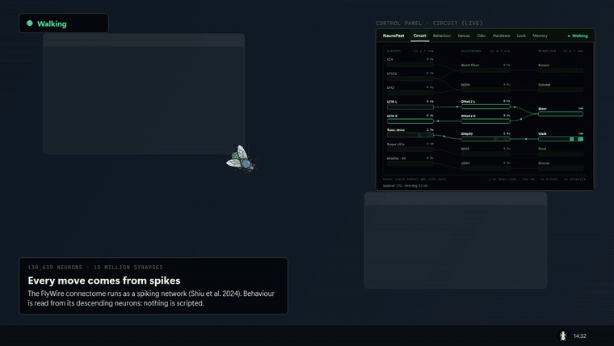

# NeuroPest

[](https://github.com/IrohAmca/NeuroPest/actions/workflows/ci.yml)
[](LICENSE)
[](https://www.python.org/downloads/)
[](https://flywire.ai/)

A desktop fly pet that roams your screen and reacts dynamically to your mouse cursor. Its behavior is directly driven by a Leaky Integrate-and-Fire (LIF) simulation of the fruit fly (*Drosophila melanogaster*) connectome extracted from **FlyWire (v783)**.

<p align="center">
  
</p>

**Current State (v0.8.0):** The mouse cursor is converted into three primary sensory streams, transformed into motor behaviors by the biological connectome:
- **Looming / approach velocity** $\rightarrow$ backward walking (MDN) when approached gently; explosive escape takeoff (Giant Fiber / DNp01) when approached rapidly.
- **Cursor bearing / proximity** $\rightarrow$ left/right steering turns (DNa02).
- **Motility & foraging drive** $\rightarrow$ tonic current into walking command neurons (DNp09 / P9).
- **Touch / hover on head** $\rightarrow$ antennal and head grooming (aDN1 / aDN2) via cephalic mechanosensory bristles and Johnston's organ.
- **Metabolism & Hunger** $\rightarrow$ state-dependent energy consumption; starvation drives DNp09 hyperactivity, increased foraging, and proboscis extension feeding.
- **Foraging flight** $\rightarrow$ a hungry fly flies to a food source it smells but does not reach on foot, in long mode without the Giant Fiber, and lands on the food.
- **Physical boundaries & Nociception** $\rightarrow$ strict screen clamping with elastic bounce; collisions trigger PPL1 dopaminergic punishment signals that teach the Mushroom Body to avoid screen edges.
- **Visual Skin Customization** $\rightarrow$ selectable visual themes (Classic Vector, Chubby Chibi, Cyborg, Pastel Fairy, Cartoon Retro) with smooth 16-frame dorsal locomotion cycles.
- **Real Screen Vision (optional)** $\rightarrow$ the fly perceives the desktop through ommatidia and medulla column receptive fields, with hardware-isolated screen capture (`BitBlt`).
- **3D Neural Map & Lab** $\rightarrow$ stimulate or silence real groups of the spiking circuit (Giant Fiber, MDN, DNp09, DNa02, grooming DNs, LC4, LPLC2, LPC1, LC10) from the 3D view and watch the pet respond; the mushroom body does not learn while an experiment runs.

---

## Quickstart

### Option 1: Standalone Windows App (No Python Needed)
Download the latest pre-packaged `NeuroPest-v0.8.0-windows-x64.zip` from [Releases](https://github.com/IrohAmca/NeuroPest/releases), extract, and double-click `NeuroPest.exe`.

### Option 2: Run from Source with uv
```bash
uv sync
uv run neuropest
```

> **Automated Connectome Setup:** On first launch, if the pre-built biological connectome is not detected, NeuroPest automatically offers to download and initialize the FlyWire v783 connectome (~135 MB) via a one-click setup dialog. You can also run immediately in lightweight Toy Circuit mode (146 neurons), or pre-fetch data from the terminal via:
> ```bash
> uv run neuropest-download
> ```

### Key Behaviors & Controls

- **Interactive Cursor Reactions:**
  - Approaching slowly prompts the fly to **walk backwards (retreat)**.
  - Approaching rapidly triggers an immediate **escape takeoff (fly)**.
  - Moving the cursor near the fly causes it to **turn towards or away** depending on learned valence.
  - Skittishness slider adjusts loom sensitivity. Cursors farther than 700 px are ignored (idling motor).
  - **Food odor weakens the startle.** A hungry fly that smells food (a plume, or the cursor's own scent in the default
    "attractive" cursor mode) scales its looming, retreat and freeze reflexes down in proportion to the odor strength
    (`brain.odor_gate`: full reflex at no odor, none at odor x hunger >= 0.2, calibrated with `tools/probe_odor_gate.py`).
    While a hungry pet approaches the attractive cursor or sits in the middle of a plume it chases rather than flees;
    once it has eaten (hunger near 0, right after a bite) it startles as described above. With cursor mode "Disabled"
    or "Repellent" the cursor carries no food scent, so only the invisible food plumes still soften a hungry pet's
    startle.
- **Hunger & Metabolism:**
  - The fly consumes energy based on its behavioral state:
    - Resting / grooming: $\approx 0.005 / \text{s}$ (basal rate)
    - Walking: $\approx 0.015 / \text{s}$
    - Flight: $\approx 0.080 / \text{s}$ (~$16\times$ basal consumption!)
  - Satiated flies groom and rest. Hungry flies experience internal walking drive (DNp09 hyperactivity) and increased food odor sensitivity.
  - **Feeding through the taste circuit.** Three invisible food sources of different sizes lie on the screen (was
    seven); a bigger one smells stronger and further (odor radius and strength grow with the square root of the size).
    Food under the fly drives the labellar sugar receptor neurons (FlyWire `cell_sub_class` "sugar", LB3c, 32
    neurons); in the connectome they drive the proboscis motor neuron MN9 (Shiu et al. 2024), and while MN9 fires the
    fly is in the `FEED` state: it stands with its proboscis out (drawn as far out as MN9 fires) and eats in proportion
    to it. Hunger raises the sugar neurons' sensitivity (Inagaki et al. 2012; the curve is designed), so a hungry fly
    eats a food of size 1 in about ten seconds, a half-fed one stops by itself when its MN9 falls below the threshold,
    and a sated one does not start. A food eaten up appears again elsewhere. Standing still while MN9 fires is the
    decoder's stand-in for the halt of real flies (Sapkal et al. 2024: sugar recruits GABAergic neurons that inhibit
    the walking descending neurons below P9; in this model sugar does not reach P9, the neuron read for walking).
    Measured on the 15k tier (`tools/probe_sugar.py`): SUGAR at 50 / 100 / 120 Hz drives MN9 to 14-16 / 56-59 / 60-67 Hz,
    ~400 neurons spike, nothing keeps firing afterwards.
  - **Local search after a meal** [designed]: a fly that leaves a meal circles the place for up to 40 s (longer the
    hungrier it still is), as real flies do (Kim & Dickinson 2017; Corfas, Sharma & Dickinson 2019): a forced drive on
    the DNa02 of the side the meal spot lies on (the GUI gives its bearing, a path-integrator stand-in), tight circles at
    first that widen. Headless measurement: the fly spends 60-99% of the search within 200 px of the meal spot.
  - **Foraging flight.** A hungry fly (hunger >= 0.45) that smells a food source 180-~400 px away, and is not getting
    closer to it on foot, builds an urge to fly there; at full urge it takes off in long mode **without the Giant Fiber**
    (von Reyn et al. 2014: long-mode take-offs do not need it), turns toward the source first, slows on the way in and
    lands on it (`brain.GOAL_*`, `fly.GOAL_*`; the GUI tells the brain where the source is, a designed shortcut). An attack
    on the way turns it into an escape. `tools/probe_goal_flight.py` (15k tier, 6 seeds x 4 directions, food 300 px away,
    hunger 0.6): 24/24 ate, median 3.2 s, every landing on the food, no wall hits, Giant Fiber silent; walking alone 0/24.
  - Instant "Feed" and "Starve" actions are available in the control panel; live hunger percentage is badged in the system tray.
- **Screen Boundaries & Wall Avoidance:**
  - Strict 2 px safety margin ensures fly body and wings never clip outside visible screen bounds.
  - Elastic collision bounce reflects velocity inwards upon hitting screen edges.
  - Each wall impact injects a nociceptive pain stimulus (PPL1 dopaminergic pulse), training the Mushroom Body to avoid borders over time (aversive conditioning); not during a foraging flight, and not while the 3D lab manipulates the circuit.
  - Multi-monitor support enables smooth traversal across taskbars and display boundaries (or pinning to a single monitor in View settings).
- **Visual Appearance & Skins:**
  - Real-time skin selector with custom icon cards in the View settings:
    - **Classic (Vector):** Anatomical geometry; proboscis, head, thorax, and 6-legged alternating tripod gait.
    - **Chubby (Chibi):** Soft rounded body, cute wings, 16-step dorsal walk and flight animations.
    - **Cyborg (Sci-Fi):** Mecha robotic chassis, glowing cyan wings, cybernetic joints.
    - **Pastel (Fairy):** Translucent fairy wings, soft pastel palette, delicate footsteps.
    - **Cartoon (Retro):** Expressive compound eyes, retro stylized dorsal patterns.
- **Screen Capture Vision (Compound Eye Perception):**
  - Enable "Screen Capture Vision" in the control panel to replace cursor coordinate math with optical sampling of real screen pixels through ommatidia and medulla column receptive fields.
- **3D Neural Map & Lab (Learning tab):**
  - **Explore:** drag to orbit (left) or pan (right), scroll to zoom, Home or double-click resets; click a neuron to pin
    its card, which says whether its rate is a spike rate of the simulation, a designed signal or an illustration.
  - **Stimulate:** press a marked target (Giant Fiber, MDN, DNp09, DNa02 left / right, grooming DNs, LC4, LPLC2, LPC1,
    LC10 left / right): its neurons are forced to spike, like a light-gated channel, while the button is held (a click is
    a 0.3 s pulse; every stimulation ends by itself after 10 s at most). What the fly then does is the circuit's own
    response: a GF pulse takes off through its own spikes, LC4 + LPLC2 drive the GF, LPC1 drives MDN, LC10 on one side
    turns it. A click on empty space does nothing.
  - **Silence:** click a target to clamp its neurons (they cannot spike, whatever drives them), again to release it;
    silenced groups are grey, listed as chips with "Release all", and survive an engine restart (not saved).
  - While the lab is on (and 0.6 s after) the mushroom body does not learn and nothing is punished, so an experiment
    never teaches the pet fear; the status line says when the engine applied a request and what the fly did.
  - The view renders the scene at rest once per camera pose and only the live layer per frame (~9 ms a frame at
    700x410, was 150-350 ms), and slows its own frame rate when frames get expensive, so on its own timer it takes at
    most about a third of the GUI thread the pet runs on (a drag repaints on every mouse move). Opening it in its own
    window pauses the embedded copy.
- **Control Panel:**
  - Dark-themed card interface displaying real-time telemetry (Giant Fiber, MDN, Steering, MN9, real-time factor, CPU load, active neuron count, valence, hunger).
  - Collapsible **Advanced Behavior Settings** (Motility at 65%, Skittishness $\times 1.00$, Wall Pain $\times 1.00$, with a single-click reset).
  - Closing the control window minimizes it to the system tray; click the tray icon to restore.
- **System Tray Icon:**
  - Dynamic fly eye color reflects internal state: Green = Walking, Orange = Retreating, Red = Escape Flight.
  - Tooltip shows current behavioral state and live hunger percentage.
- **UI Preview:**
  - Run `uv run python tools/ui_preview.py` to render the control interface to a PNG without starting the simulation engine.

---

## Real Data (FlyWire v783)

Raw datasets and connectome files are ignored by git (`data/raw/`, `data/circuits/`). Download sources and git blob hashes (`git hash-object`):

| File | Source | Size | SHA-1 |
|---|---|---|---|
| `Connectivity_783.parquet` | [github.com/philshiu/Drosophila_brain_model](https://github.com/philshiu/Drosophila_brain_model) | 100.8 MB | `d386555d1a5f40ebfa1380bcb05b1fab044855fd` |
| `Completeness_783.csv` | same repository | 3.3 MB | `b5a26b82b69a3c2e7fd99cd6810c36fc8f0e492b` |
| `Supplemental_file1_neuron_annotations.tsv` | [github.com/flyconnectome/flywire_annotations](https://github.com/flyconnectome/flywire_annotations) (`supplemental_files/`) | 31.7 MB | `02e72f6c8161d3465f77fec0edf96c5d98027a9e` |

### Build Pipeline

```bash
mkdir -p data/raw
git clone --depth 1 https://github.com/philshiu/Drosophila_brain_model.git /tmp/shiu          # ~190 MB
git clone --depth 1 https://github.com/flyconnectome/flywire_annotations.git /tmp/fwann
cp /tmp/shiu/Connectivity_783.parquet /tmp/shiu/Completeness_783.csv data/raw/
cp /tmp/fwann/supplemental_files/Supplemental_file1_neuron_annotations.tsv data/raw/
git hash-object data/raw/*               # verify matches table above

uv run python tools/build_flywire.py     # ~30s: builds data/circuits/flywire_v783.npz (125 MB) + tiers/
uv run python tools/build_eye.py         # eye models: data/circuits/eye.npz and field.npz (for visual input)
uv run python tools/build_mushroom.py    # optional: biological Mushroom Body (KC/MBON/DAN/PN), data/circuits/mushroom_flywire.npz (~200 kB)
uv run python tools/fidelity.py          # ~5min: data/circuits/tiers.json (fidelity and speed metrics)
# optional probes: tools/fidelity.py 5000 15000 30000 --dt 0.1 0.5 1.0 | --image | --mirror
# behavior probes (closed loop, headless): tools/probe_goal_flight.py, tools/probe_odor_gate.py
# taste and runaway probes: tools/probe_sugar.py, tools/probe_runaway.py
```

The circuit cache carries a version (`paths.CACHE_VERSION`): its neuron groups live inside the file, so a cache built
by an older version (without the `SUGAR` / `MN9` groups) is offered for a rebuild at startup (the raw files are
downloaded only if missing); kept, the pet feeds by a designed rule on the sugar input instead.

> **Note on shallow clones:** Standard shallow cloning is sufficient; files in these repos are regular git objects, not Git LFS. `sez_neurons.pickle` is deliberately omitted because pickle can execute arbitrary code and is not needed for circuit construction.

**`tiers.json` is machine-specific.** Error columns (takeoff, retreat, steering, descending neuron correlation) are intrinsic to the circuit and drivers. Speed columns reflect single-core throughput measured on the benchmarking host; run `tools/fidelity.py` locally to calibrate for your CPU.

### License, Attribution & Scientific References

- **Code License:** [PolyForm Noncommercial License 1.0.0](LICENSE) (SPDX: `PolyForm-Noncommercial-1.0.0`).
- **FlyWire Dataset Terms:** **CC BY-NC 4.0** (Attribution required, Non-Commercial use only; confirmed at [flywire.ai/guidelines](https://flywire.ai/guidelines)).
- **Upstream Code:** Shiu et al. (2024) LIF reference model is MIT licensed.
- This project is distributed strictly for non-commercial research and educational use. Commercial use requires permission from FlyWire.
- **Citing NeuroPest:** See [CITATION.cff](CITATION.cff) for GitHub and software citation metadata.
- **Comprehensive Bibliography:** See [REFERENCES.md](REFERENCES.md) for full citations, biological mechanism mapping, and BibTeX entries covering all neural subsystems (Connectome, Descending Motor Control, Mushroom Body, Metabolism, and Vision).
- **Foundational Studies:**
  - Dorkenwald et al. 2024 (*Nature* 634:124–138, FlyWire connectome). [doi:10.1038/s41586-024-07558-y](https://doi.org/10.1038/s41586-024-07558-y)
  - Schlegel et al. 2024 (*Nature* 634:139–152, cell types and annotations). [doi:10.1038/s41586-024-07686-5](https://doi.org/10.1038/s41586-024-07686-5)
  - Shiu et al. 2024 (*Nature* 634:210–219, whole-brain LIF computational model). [doi:10.1038/s41586-024-07763-9](https://doi.org/10.1038/s41586-024-07763-9)
  - Bidaye et al. 2014 (*Science* 344:97–101, MDN backward walking). [doi:10.1126/science.1249964](https://doi.org/10.1126/science.1249964)
  - Bidaye et al. 2020 (*Neuron* 108:694–707, DNp09 forward walking drive). [doi:10.1016/j.neuron.2020.08.016](https://doi.org/10.1016/j.neuron.2020.08.016)
  - Rayshubskiy et al. 2025 (*eLife* 14:RP103565, DNa02 steering). [doi:10.7554/eLife.103565.1](https://doi.org/10.7554/eLife.103565.1)
  - Aso et al. 2014 (*eLife* 3:e04577 & e04580, Mushroom Body architecture & MBON valence). [doi:10.7554/eLife.04577](https://doi.org/10.7554/eLife.04577)
  - Hige et al. 2015 (*Neuron* 88:985–998, dopamine-dependent plasticity). [doi:10.1016/j.neuron.2015.11.003](https://doi.org/10.1016/j.neuron.2015.11.003)
  - Krashes et al. 2009 (*Cell* 139:416–427, hunger gating of dopamine memory). [doi:10.1016/j.cell.2009.08.035](https://doi.org/10.1016/j.cell.2009.08.035)

---

## Neural Circuit Architecture

The full connectome consists of **138,639 neurons** and **15.1 million synaptic edges**, with synaptic weight $\text{sign} \times \text{synapse count} \times 0.275\text{ mV}$. Mouse cursor activity is translated into Poisson spike trains on sensory projection neurons, and motor outputs are decoded from descending neurons (DNs):

| Cursor Stimulus | Sensory Neurons | Motor Readout | Resulting Behavior | Reference |
|---|---|---|---|---|
| Approach speed (looming) | LPLC2 (size) + LC4 (velocity) | DNp01 (Giant Fiber) | Escape flight / takeoff | Ache 2019; von Reyn 2017 |
| Approach speed (mild) | LPC1 (functional surrogate) | MDN | Backward walking | Bidaye 2014 |
| Bearing & Proximity | LC10a/c-2/d (ipsilateral) | DNa02 (ipsilateral) | Ipsilateral steering turn | Rayshubskiy et al. |
| Motility slider | Tonic current | DNp09 / P9 | Forward walking | Bidaye 2020 |
| Head hover / touch | Cephalic bristles (BM_*) + JO-C/E | DNg62 (aDN1) + DNge078 (aDN2) | Head & antenna grooming | Hampel 2015; Shiu 2024 |
| Food under the fly (x hunger) | Labellar sugar receptor neurons (LB3c, `SUGAR`) | MN9 (CB0701) | Feeding: proboscis out, the fly stands and eats | Shiu 2024; Inagaki 2012; Sapkal 2024 |
| A meal just ended (designed) | Forced DNa02 drive toward the meal spot | DNa02 | Local search: circles around the place | Kim & Dickinson 2017; Corfas 2019 |
| Hunger state | Metabolic deficit tonic drive | DNp09 | Hyperactivity & foraging | Krashes 2009 |
| Food in flying range, not reached on foot | Food odor x hunger + source position (designed) | none (no Giant Fiber) | Foraging flight, landing on the food | von Reyn 2014 |
| Boundary collision | Border impact | PPL1 dopaminergic cluster | Nociceptive pain conditioning | Claridge-Chang 2009 |

### Motor Control & Latency

Takeoff is decoded as an **event** rather than a continuous firing rate: in biological fruit flies, 1–2 spikes from the Giant Fiber trigger immediate escape jumping. Thus, two GF spikes within a 10 ms window (`BrainSpec.gf_event_spikes`) immediately switch state to `FLY`. An 80 ms exponentially filtered rate pathway acts as an exit condition. Measured latency (`tools/latency.py`, 15k tier, 8 seeds):
- Takeoff takes 8 ms (down from 16 ms) at $20/\text{s}$ expansion.
- Takeoff takes 14 ms at $10/\text{s}$ expansion.
- Takeoff threshold begins at $\approx 4/\text{s}$ expansion.

### Behavioral States & Precedence

1. **Takeoff / Fly** (`FLY`)
2. **Retreat / Backward Walk** (`RETREAT`)
3. **Freeze** (`FREEZE`)
4. **Feed** (`FEED`): while the smoothed MN9 rate is above 15 Hz (until it falls below 5 Hz)
5. **Groom** (`GROOM`)
6. **Walk** (`WALK`) / **Stand** (`STAND`)

Higher priority states immediately interrupt lower states; state transitions enforce minimal durations and hysteresis to prevent jitter. 

- **Two take-off modes:** an escape (`fly_short`) is always a Giant Fiber take-off; a foraging flight (`fly_long`) toward a food source does not use the Giant Fiber (see Hunger & Metabolism).
- **Freezing:** Model has no single dedicated freeze neuron; freezing is an engineered behavioral rule (`BrainSpec.freeze_on = 0.7`). If looming rate exceeds 0.7/s without triggering escape or retreat, the fly freezes for $\ge 1.2\text{ s}$ until expansion drops below 0.3/s.
- **Escape Direction:** DNp02/DNp11 encode lateral LC4 gradients. Escape trajectory is directed opposite to cursor heading (`fly.py`).
- **Left-Right Symmetrization:** Synaptic weights and connection signs are bilaterally balanced (`flywire.py`, `lif_wgpu.py`) to eliminate unilateral steering biases under symmetrical stimuli.
- **The olfactory / mushroom-body runaway and the LC10 ceiling:** the LIF model has no spike-frequency adaptation and no
  short-term synaptic depression, which keep the real antennal lobe graded (Kazama & Wilson 2008; Olsen & Wilson 2008).
  Driven hard (food-odor projection neurons at 10 Hz, the "sugar/low_salt" taste neurons at 100 Hz, LC10 on one side
  from ~55-70 Hz), the brain falls into a self-sustained state of ~9,500 neurons (Kenyon cells, ALPNs, olfactory
  receptor neurons, antennal-lobe and lateral-horn local neurons, DANs) that keeps firing after the input ends, with
  DNa02 locked to one side. An earlier ranking protocol (LC10 at 100 Hz) fell into it, so that network filled most of
  the 15,000 tier, and a well-trained pet lured by the cursor (learned desire x2.5 on the bearing drive, ~75 Hz on
  LC10) circled to the left at ~30x the CPU. `states.LC10_MAX_HZ` (40 Hz) now caps the brain's LC10 drive, the ranking
  protocols stay under it, and the 15,000 tier no longer holds that network (`tools/probe_runaway.py`).

---

## Reduced Connectome Tiers

Because the network exhibits minimal spontaneous baseline activity without input, neurons that never fire can be pruned without affecting circuit output. Neurons are ranked by total spike counts across training input protocols (with input/anchor neurons always retained). Tier $N$ represents the top $N$ ranked neurons.

Benchmarked on Intel Core i5-10300H (single-core, $\text{d}t = 0.5\text{ ms}$; error relative to full 138k connectome):

| Neurons | Takeoff (GF) Error | Retreat (MDN) Error | Steering (DNa02) Error | DN Correlation | Speed (Avg / Worst-case) |
|---:|---:|---:|---:|---:|---:|
| 2,000 | 29% | 75% | 98% | 0.743 | $\times 65$ / $\times 28$ |
| 5,000 | 13% | 20% | 23% | 0.993 | $\times 27$ / $\times 7.0$ |
| 10,000 | 9% | 6% | 10% | 0.997 | $\times 20$ / $\times 4.4$ |
| **15,000 (Default)** | **0.6%** | **5.4%** | **0.8%** | **0.999** | **$\times 11$ / $\times 2.1$** |
| 20,000 | 0.1% | 0.5% | 1.2% | 1.000 | $\times 5.7$ / $\times 1.7$ |
| 50,000 | 0% | 0% | 0.9% | 0.999 | $\times 4.0$ / $\times 0.5$ |
| 138,639 (Full) | 0% | 0% | 0% | 1.000 | $\times 2.5$ / $\times 0.4$ |

> **Key takeaway:** At **15,000 neurons**, fidelity is virtually indistinguishable from the whole brain ($r = 0.999$) while maintaining an average speedup of **$\times 11$ real-time** on a single CPU core. Idle CPU load is negligible ($\approx 0\%$) when the mouse cursor is far away.

---

## Screen Capture Vision & Desktop Perception

When "Screen Capture Vision" is enabled in the control panel, the fly samples actual desktop pixels through an ommatidial cone matching Drosophila compound eye optics instead of receiving synthetic cursor coordinates. Each medulla column points in a specific azimuth and elevation, sampling the desktop plane.

```bash
uv run python tools/build_eye.py       # builds eye.npz and field.npz (+ eye_map.png)
uv run python tools/vision_runner.py   # end-to-end worker test with scripted motions
```

### Screen Capture Pipeline (`neuropest/capture.py`)

- **Subprocess Isolation:** Screen capture runs in a dedicated worker process communicating via zero-lock shared memory (`multiprocessing.Array`).
- **GDI BitBlt:** Captures a 480×480 px window centered around the fly ($\approx 5\text{ ms/frame}$, converted to grayscale uint8 with Numba).
- **Dynamic Framerate:** 8 fps during movement ($\approx 4\%$ CPU core); drops to 2 fps when scene is static ($\approx 1\%$ CPU core).
- **Overlay Isolation:** Uses `SetWindowDisplayAffinity(hwnd, WDA_EXCLUDEFROMCAPTURE)` (0x11) so the fly's own sprite is completely excluded from desktop capture—the fly never mistakes itself for a predator!
- **Multi-Monitor & DPI:** Per-monitor DPI awareness handles virtual screen offsets, including negative coordinates (e.g. `-1920, 0`).

### Retinotopic Motion Detectors (`neuropest/vision.py`)

- **Looming Expansion Detector (LPLC2 / LC4):** Detects symmetric outward edge expansion across four quadrants. LPLC2 receives receptive-field area coverage (angular size), while LC4 receives expansion velocity.
- **Small Target Motion Detector (LC10):** Measures localized dark or bright contrast relative to surrounding background.

---

## Mushroom Body & Reinforcement Learning

The Mushroom Body mediates associative learning via three-factor synaptic plasticity at Kenyon Cell $\to$ MBON synapses, gated by Dopaminergic Neurons (DANs).

- **Dopamine as Prediction Error (RPE):** Dopamine signal represents reinforcement minus cue valence already learned ($\text{Reinforcement} - \text{Valence}$). A fully anticipated reward or threat produces zero net learning.
- **Extinction Learning:** An expected reinforcement that does not arrive triggers active memory extinction (`eta_ext`), decaying associative weights.
- **Valence Modulation:** Learned valence ($V \in [-1, +1]$) dynamically modulates behavior:
  - Positive valence ($V > 0$): increases forward walking drive and attraction towards the cursor.
  - Negative valence ($V < 0$): heightens skittishness, reverses steering away from the cursor, and triggers defensive takeoff.
- **Visual Learning from Connectome PNs:** When visual input is active, visual projection neurons reaching Kenyon cells (aMe12, MTe32, MTe30, LTe25, MTe40 for cursor; aMe26, LTe72, MTe37 for looming) directly stimulate KCs through connectome receptive fields (`tools/probe_mb_vision.py`).
- **Real FlyWire Wiring Mode (Opt-in):** Learning > *Mushroom Body Model* switches between the designed layer (2,000 Kenyon cells, default) and the real anatomical connectivity (`data/circuits/mushroom_flywire.npz`, built by `tools/build_mushroom.py` or the in-app download) with 5,177 Kenyon cells, 96 MBONs (35 types), and biological PAM/PPL1 innervation. The choice is saved as `mb_wiring` (`random` / `flywire`) in `data/preferences.json`; each model keeps its own memory file. The environment variable `NEUROPEST_MB=flywire|random` overrides the saved choice and locks the selector; without a usable npz the designed model runs.
- **Persistence:** Learned memories persist between launches in `data/memory/fly_memory.npz` (or `fly_memory_flywire.npz`), with a one-click "Reset Memory (Amnesia)" button in the Learning tab.
- **Lab pause:** while the 3D lab stimulates or silences neurons (and 0.6 s after), plasticity is paused (`MushroomBody.step(plastic=False)`), nothing is punished and no memory is saved, so an experiment never becomes part of what the pet learned. The learning sandbox's buttons (reward, punishment, food odor and cursor cues) are designed signals for the mushroom body; they do not drive spiking neurons.

---

## Simulation Engine & Hardware Acceleration

The core simulation engine implements leaky integrate-and-fire dynamics with exact exponential integration and 1.8 ms synaptic delay:

- `LIFEngine` (`neuropest/engine/lif_numba.py`): Event-driven Numba CPU engine. Only updates active neurons each step; computational cost scales with active spikes rather than total network size.
- `ReferenceEngine`: Dense NumPy implementation used as an oracle for unit test verification.
- `WGPUEngine` (`neuropest/engine/lif_wgpu.py`): Cross-platform GPU acceleration via WebGPU (`wgpu`). Supports Vulkan, Metal, and DirectX on NVIDIA, AMD, Intel, and Apple Silicon without requiring CUDA.
- **Silencing** (`set_silenced`, the lab's lesions) behaves the same on all three engines: a silenced neuron is held in
  the refractory state (it integrates nothing and cannot cross threshold), its forced and current drive is dropped
  (kept aside, so releasing it brings the drive back), and on release v and g return to rest so the input it collected
  while clamped does not fire a burst (`engine/hostdrive.py`; tested against the reference engine, also on the GPU).
- **GUI <-> worker link:** two shared double arrays of 64 slots, fresh on every engine start, one writer per slot.
  Levels (cursor, pose, hunger, the food goal) are latest-value-wins; events (forget, meals, the learning sandbox's
  injections) are counters the GUI only adds to, so none is lost between two reads; the lab's request is a block under a
  sequence lock that the worker applies whole and acknowledges (`runner.py`, slot map at the top).

### GPU Acceleration

GPU acceleration is built-in out of the box via WebGPU (`wgpu`). No CUDA installation or extra flags required.

Select Compute in the control panel: **Auto / CPU / GPU**. "Auto" automatically delegates circuits of 50,000+ neurons to the GPU while running smaller tiers on the lightweight CPU engine.

Benchmarked on full connectome (138,639 neurons, 15.1M synapses, $\text{d}t = 0.5\text{ ms}$):

| Input Load (Spikes/s) | CPU (Numba) | NVIDIA GTX 1650 (Vulkan) | Intel UHD Graphics (Vulkan) |
|---|---:|---:|---:|
| 10% Retina @ 20 Hz (21k) | $\times 9 - 11$ | $\times 12.8$ | $\times 3.4$ |
| 50% Retina @ 20 Hz (105k) | $\times 1.9$ | $\times 13.7$ | $\times 3.0$ |
| 50% Retina @ 50 Hz (265k) | $\times 1.0 - 1.4$ | $\times 11.7$ | $\times 3.1$ |
| 100% Retina @ 50 Hz (538k) | $\times 0.5$ | $\times 9.1$ | $\times 2.5$ |
| 100% Retina @ 100 Hz (1.1M) | $\times 0.2 - 0.3$ | $\times 7.0$ | $\times 2.1$ |
| Looming 50 Hz (33k) | $\times 0.4$ | $\times 8.6$ | $\times 2.7$ |

---

## Repository Structure

```
NeuroPest/
├── neuropest/
│   ├── app.py              # Main desktop application, transparent overlay & Qt lifecycle
│   ├── brain.py            # Neural network coordinator, sensory encoding & motor decoding
│   ├── capture.py          # Isolated BitBlt screen capture worker with shared memory
│   ├── control.py          # Dark-themed control panel & telemetry window
│   ├── data_manager.py     # One-click connectome download & first-run setup
│   ├── eyebuild.py         # Medulla column alignment & ommatidial cone projection
│   ├── eyeview.py          # Shared-memory snapshots for the fly's-eye preview
│   ├── fly.py              # Kinematics, heading, tripod gait phase, screen boundary physics, foraging-flight steering
│   ├── flywire.py          # FlyWire connectome loader, ranking, tiers & symmetrization
│   ├── mb_geometry.py      # 3D coordinates of the mushroom body and whole-brain circuits
│   ├── mb_view3d.py        # 3D neural map: cached rendering, inspector cards, the lab tools
│   ├── mbbuild.py          # Extraction of the real mushroom-body wiring (KC/MBON/DAN/PN)
│   ├── metabolism.py       # Energy consumption, hunger states & proboscis extension
│   ├── mushroom.py         # Mushroom Body RL (3-factor plasticity, prediction error, MBONs)
│   ├── paths.py            # Standard dataset, cache, and asset directory paths
│   ├── pheromone.py        # Odor field, bilateral antennal tropotaxis & the foraging goal
│   ├── preferences.py      # Saved user settings (data/preferences.json)
│   ├── render.py           # Procedural vector fly & multi-skin sprite renderer
│   ├── runner.py           # Background simulation worker, shared-memory slot map & lab protocol
│   ├── states.py           # Behavioral states, gears and the lab's neuron groups
│   ├── theme.py            # Modern UI styling, color palettes & tray icons
│   ├── toy_circuit.py      # Small synthetic circuit (runs without the connectome)
│   ├── tray.py             # System tray icon & menu
│   ├── vision.py           # Retinotopic feature detectors (looming & small target)
│   ├── visual.py           # Optical projection neuron drive & visual learning cues
│   ├── assets/skins/       # Sprite animations (idle, walk, fly) and UI thumbnails
│   └── engine/             # LIF engines (Numba CPU, WGPU WebGPU, NumPy reference) & shared silencing
├── tools/                  # Connectome builders, fidelity & behavior probes, vision calibration, benchmarks
└── tests/                  # Pytest verification test suite (~300 unit and integration tests)
```

---

## Testing

Run the full automated test suite:

```bash
uv run pytest
```

Tests validate engine equivalence (including silencing on the CPU, reference and GPU engines), connectome tier indexing, the shared-memory slot map and lab protocol, screen capture memory isolation, Mushroom Body learning dynamics and the lab's plasticity pause, the foraging flight (decision, steering, landing), the 3D view (picking, HUD layout, lab tools, render caching), metabolism states, pheromone tropotaxis, multi-skin rendering, and physical margin reflections. GPU tests are skipped without a GPU adapter.

---

## License & Attribution

This project is licensed under the **[PolyForm Noncommercial License 1.0.0](LICENSE)** (SPDX: `PolyForm-Noncommercial-1.0.0`).

### Permitted Uses
- You are free to inspect, run, modify, fork, and distribute the code for **non-commercial purposes**, including personal study, research, education, experimentation, and hobby projects.

### Restrictions
- Any use primarily intended for or directed toward commercial advantage or monetary compensation is **strictly prohibited** without explicit written permission from the copyright holder.

### Third-Party Data & Upstream Acknowledgements
- **Drosophila Brain Model:** Leaky integrate-and-fire simulation baseline and synaptic parameters adapted from Shiu et al. (2024) (MIT License).
- **FlyWire Connectome Dataset (v783):** Connectome wiring and annotations by Dorkenwald et al. (2024) and Schlegel et al. (2024) (licensed under [CC BY 4.0](https://creativecommons.org/licenses/by/4.0/)).
- **PySide6 / Qt:** Licensed under LGPLv3.

